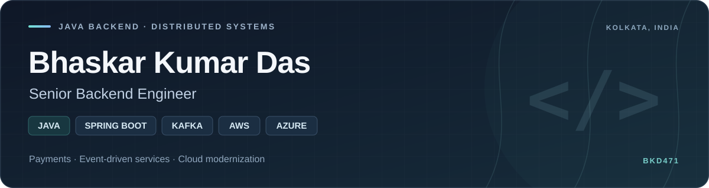

  

  <a href="mailto:backend.connect47@gmail.com">Email</a> &nbsp; · &nbsp;
  <a href="https://www.linkedin.com/in/bhaskar-kumar-das-64019a168">LinkedIn</a> &nbsp; · &nbsp;
  <a href="https://github.com/BKD471/EventDrivenEcommerceMicroServices">Featured repository</a>

I'm **Bhaskar**, a backend engineer at **Accenture**, previously at **TCS**, based in Kolkata, India. I build Java and Spring Boot services and work on payment integrations, event-driven systems, batch processing and cloud modernization.

## Featured project

### [Event-Driven E-Commerce Microservices](https://github.com/BKD471/EventDrivenEcommerceMicroServices)

**Personal project · Active development**

An e-commerce backend with customer, product, order, payment and notification services, built using Java, Spring Boot, Spring Cloud and Kafka.

- Coordinate orders, inventory reservations and payments through a **Saga with compensating actions**.
- Publish payment events through a **transactional outbox**, with idempotent payment operations and Kafka notifications.
- Run **restartable Spring Batch jobs** for saga recovery, reconciliation, reporting and catalog import/export.
- Handle Kafka retries and dead letters, with **S3-backed failure storage** and **Redis caching**.
- Add service metrics and logs with **Prometheus, Grafana and Loki**, and unit and integration tests with **JUnit and Mockito**.

**Explore the code:** [Saga recovery jobs](https://github.com/BKD471/EventDrivenEcommerceMicroServices/blob/master/order/src/main/java/com/forsaken/ecommerce/order/batch/SagaRecoveryBatchConfig.java) · [Payment outbox publisher](https://github.com/BKD471/EventDrivenEcommerceMicroServices/blob/master/payment/src/main/java/com/forsaken/ecommerce/payment/service/PaymentOutboxPublisher.java) · [Catalog batch jobs](https://github.com/BKD471/EventDrivenEcommerceMicroServices/blob/master/product/src/main/java/com/forsaken/ecommerce/product/batch/CatalogBatchConfig.java)

**Next milestones:** cloud deployment and CI/CD.

## Professional work

### OP Online Payments — Vendor API Solution (VAPI)

**Accenture · Corporate banking · Backend modernization**

I contribute to payment-system integrations and the migration of backend workloads from AWS to Azure. My work includes:

- **Java 21 and Spring Boot 4 modernization**, dependency updates and compatibility changes.
- **S3-to-Azure Blob Storage migration** as part of the wider cloud migration.
- API client generation with **OpenAPI Generator and Mustache templates**, plus mocks and integration/migration testing.
- Billing and database-cleanup batch workloads for **Kubernetes CronJobs**, including JDBC execution locking and idempotent processing.
- **AKS deployment preparation** using Kubernetes, Helm and Azure Key Vault, alongside API authentication, callback signing and certificate configuration.

This section is a high-level overview of my professional contributions.

## Core tools

| Area | Technologies |
| --- | --- |
| Backend | Java · Spring Boot · Spring Cloud · Spring Data JPA · REST APIs |
| Messaging and reliability | Apache Kafka · Avro · Schema Registry · Saga · Transactional Outbox · Resilience4j |
| Batch and data | Spring Batch · PostgreSQL · Redis · DynamoDB |
| Cloud and delivery | AWS · Azure · Amazon S3 · Azure Blob Storage · Docker · Kubernetes · AKS · Helm |
| Testing and observability | JUnit · Mockito · Prometheus · Grafana · Loki · CloudWatch |

## Credentials

- **Confluent Certified Developer for Apache Kafka (CCDAK)** — December 2024
- **AWS Knowledge: Serverless** badge — March 2025
- **Reinvention with Agentic AI** badge, Accenture — December 2025
