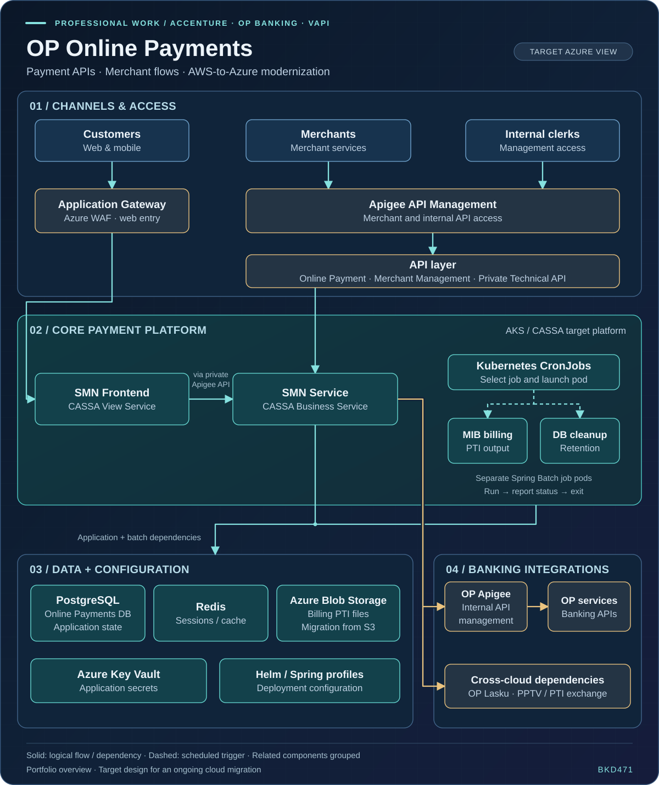

# OP Online Payments — Vendor API Solution (VAPI)

[← Back to the portfolio](../README.md#professional-work)

**Employer:** Accenture  
**Role:** Packaged Application Development Senior Analyst · Java backend engineering  
**Client / domain:** OP Banking, Finland · Corporate banking and online payments  
**Team:** Vendor API Solution (VAPI)  
**Employment:** June 2024 – Present

## Project context

OP Online Payments connects customer payment journeys, merchant-facing APIs and internal banking integrations. Within VAPI, I contribute to modernizing the Java backend and moving workloads from AWS to Azure while preserving existing payment and billing behavior.

The work combines application upgrades, generated API clients, storage changes, scheduled billing and cleanup jobs, configuration, testing and deployment preparation. The architecture below is a **conceptual target view** of the wider migration; my contribution areas are described separately.

## Architecture

[Open the full-size architecture diagram](../assets/op-online-payments-architecture.svg)

### How the system fits together

1. **Customer access:** web and mobile payment journeys reach the frontend through Azure Application Gateway with WAF protection.
2. **API access:** merchant and internal-management requests use Apigee and the relevant payment or merchant-management APIs. The frontend-to-business-service interaction also uses a private API route.
3. **Application runtime:** the target AKS/CASSA platform hosts the SMN frontend and SMN business service.
4. **Scheduled processing:** Kubernetes CronJobs select billing or cleanup in a separate Spring Batch application. Each job runs, reports success or failure, and exits.
5. **Data and configuration:** PostgreSQL holds application state; Redis supports sessions/cache; Azure Blob Storage is the target for billing PTI files migrated from S3. Key Vault and Helm/Spring profiles provide secrets and deployment configuration.
6. **Banking integrations:** internal banking APIs are reached through OP API management. Remaining cross-cloud dependencies and file-exchange integrations are separate paths.

The diagram groups logical dependencies for readability. Target-environment rollout and production cutover are separate delivery milestones.

## My contributions

| Area | Work and engineering focus |
| --- | --- |
| Java and Spring modernization | Java 21 / Spring Boot 4 compatibility, dependency updates and integration adjustments. |
| API client generation | OpenAPI Generator and Mustache templates, with mocks and integration/migration testing. |
| Cloud storage | Adapting S3-based storage integration to Azure Blob Storage as part of the cloud migration. |
| Batch implementation | Separate Java 21 Spring Batch billing and database-cleanup jobs selected by Kubernetes CronJobs. |
| Billing behavior | Tests around banking-calendar decisions, billing periods, payment selection, calculations and PTI file-format compatibility. |
| Cleanup behavior | Retention-boundary tests checking which records are deleted and which must remain. |
| Failure handling | Bounded banking-calendar HTTP calls, explicit failure outcomes and tests for delayed or unsuccessful responses. |
| Log protection | Removing banking-calendar API keys from application logs and verifying protection on success and error paths. |
| Execution semantics | Documenting scheduled-execution controls, manual-rerun limitations, uncertain delivery outcomes and coordinated cutover conditions. |
| Deployment and security | AKS preparation, Helm and Spring profiles, Key Vault, API authentication, callback signing and certificate configuration. |

## Engineering decisions and behavior

### Separate payment-serving traffic from scheduled work

Billing and cleanup run as separate job invocations in the batch application, with Kubernetes providing the schedule. This gives each invocation an explicit lifecycle and completion status while the payment-serving application continues its own work.

### Preserve business behavior during modernization

Billing tests cover calendar decisions, billing-period boundaries, transaction calculations and PTI output formatting. Cleanup tests exercise records before, at and after the retention cutoff, including calendar edge cases. These checks make compatibility visible during the runtime and platform changes.

### Treat unavailable dependencies as failures

A failed banking-calendar lookup must not be interpreted as a valid non-banking day. The client uses bounded connection/read timeouts, and failure-path tests verify that delayed or unsuccessful responses produce a failed lookup/job.

### Describe execution guarantees precisely

CronJob overlap controls apply to scheduled executions of the same CronJob. They do not establish duplicate prevention across manual runs, different jobs or downstream file processing. A deterministic Blob object key also does not prove that a downstream consumer processes a file only once.

My work here includes documenting these limits and the investigation/escalation steps for uncertain delivery outcomes.

## Validation performed

- Exercised the billing application as a standalone Java 21 JAR and in a Docker container.
- Used a local PostgreSQL database with synthetic payment data and a mock banking-calendar API.
- Verified successful billing output and failure reporting when calendar access fails.
- Added focused tests for billing compatibility, retention boundaries, bounded HTTP behavior and sensitive-log protection.

Environment-specific connectivity, credentials, output storage and scheduled execution require validation in the target environment as part of deployment preparation.

## Technology areas

**Java · Spring Boot · Spring Batch · REST APIs · OpenAPI Generator · Mustache · PostgreSQL · Redis · AWS / S3 · Azure Blob Storage · Azure Key Vault · Docker · Kubernetes · AKS · Helm · Apigee**

## Related work

- [Sainsbury's purchase-order management at TCS](sainsburys-professional-work.md)
- [Independent event-driven e-commerce project](https://github.com/BKD471/EventDrivenEcommerceMicroServices)

