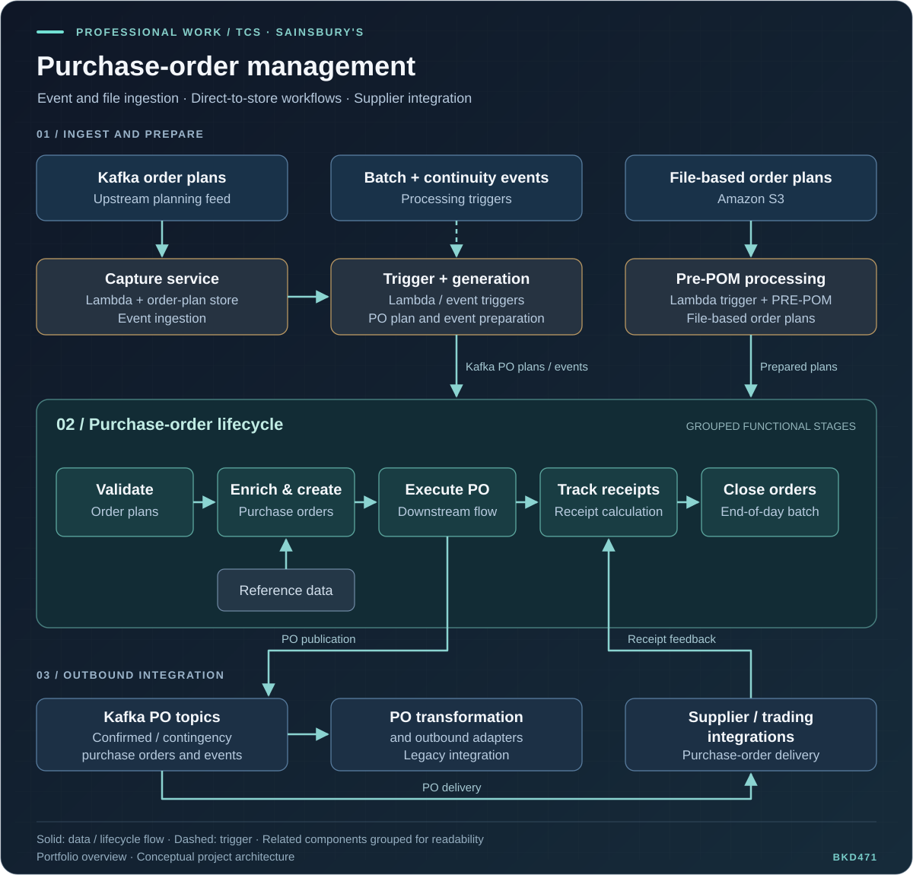

# Sainsbury's — Purchase Order Management

[← Back to the portfolio](../README.md#professional-work)

**Employer:** Tata Consultancy Services (TCS)  
**Role:** Systems Engineer / Java backend development  
**Employment period:** April 2021 – June 2024  
**Domain:** Retail, purchase-order management and direct-to-store integration

## Project context

The project connected upstream order planning with the purchase-order lifecycle and downstream supplier integrations. It included event-based ingestion and file-based processing so that migrated and non-migrated order-plan flows could feed the wider retail process.

The functional lifecycle covered validation, enrichment and purchase-order creation, execution, receipt tracking and end-of-day closure.

## My contributions

- Developed Java and Spring Boot services for retail workflows covering orders, inventory, payments and notifications.
- Implemented asynchronous Kafka messaging across six services using Amazon MSK, Avro and Schema Registry.
- Containerized backend services with Docker and deployed them on Amazon ECS Fargate.
- Built AWS Lambda workflows integrating Amazon Aurora, DynamoDB and S3.
- Added CloudWatch monitoring and AWS X-Ray tracing for application visibility, failure investigation and performance analysis.
- Contributed to deployment and API response-time improvements.

## Architecture

[Open the diagram at full size](../assets/sainsburys-pom-architecture.svg)

The illustration groups related services and integration steps into a high-level view of the project. Arrows represent logical flows and lifecycle progression.

### Processing flow

1. **Event ingestion:** Order plans arrive through Kafka and are captured in an order-plan store.
2. **Plan preparation:** Batch-completion and continuity triggers coordinate generation of purchase-order plans and events.
3. **File ingestion:** A separate Amazon S3 and pre-POM processing path handles file-based order plans.
4. **Purchase-order processing:** The wider POM flow validates inputs, enriches them with reference data, creates and executes purchase orders, tracks receipts and closes orders at end of day.
5. **Outbound integration:** Kafka PO topics connect the platform to downstream supplier/trading integrations and to transformation and outbound-adapter flows.
6. **Receipt feedback:** Downstream receipts feed the tracking stage of the purchase-order lifecycle.

### Technology roles in my work

| Area | Technologies | Contribution |
| --- | --- | --- |
| Backend services | Java, Spring Boot | Retail service development |
| Asynchronous integration | Apache Kafka, Amazon MSK, Avro, Schema Registry | Messaging across six services |
| Container delivery | Docker, Amazon ECS Fargate | Containerization and deployment |
| Event and data processing | AWS Lambda, Amazon Aurora, DynamoDB, S3 | Serverless workflows and data integration |
| Observability | CloudWatch, AWS X-Ray | Monitoring and distributed tracing |

## Connection to my portfolio

This professional experience provides the retail and cloud-integration context alongside my [personal e-commerce project](https://github.com/BKD471/EventDrivenEcommerceMicroServices) and [OP Online Payments work at Accenture](../README.md#op-online-payments--vendor-api-solution-vapi). The personal project is an independent work sample.

